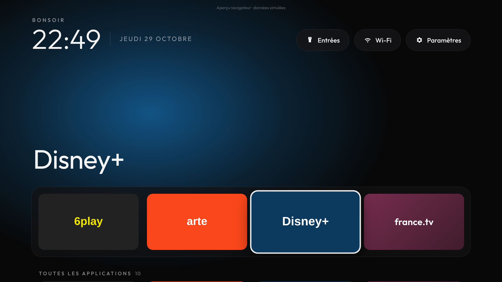
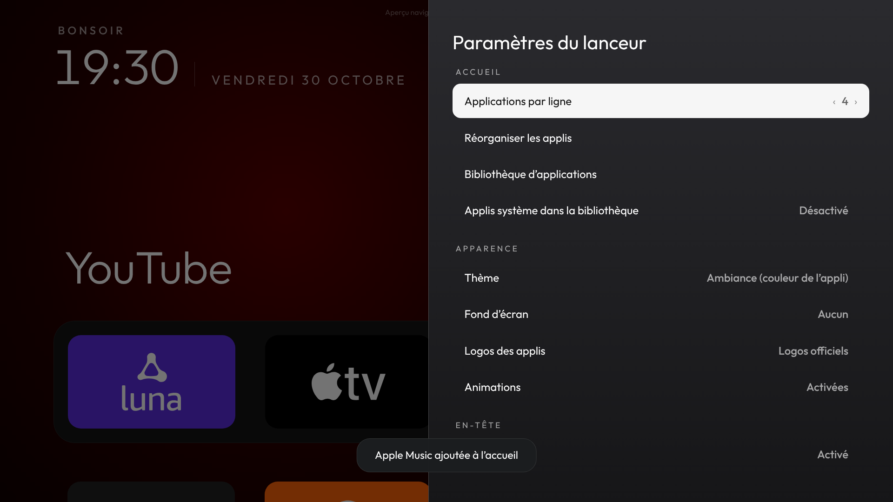
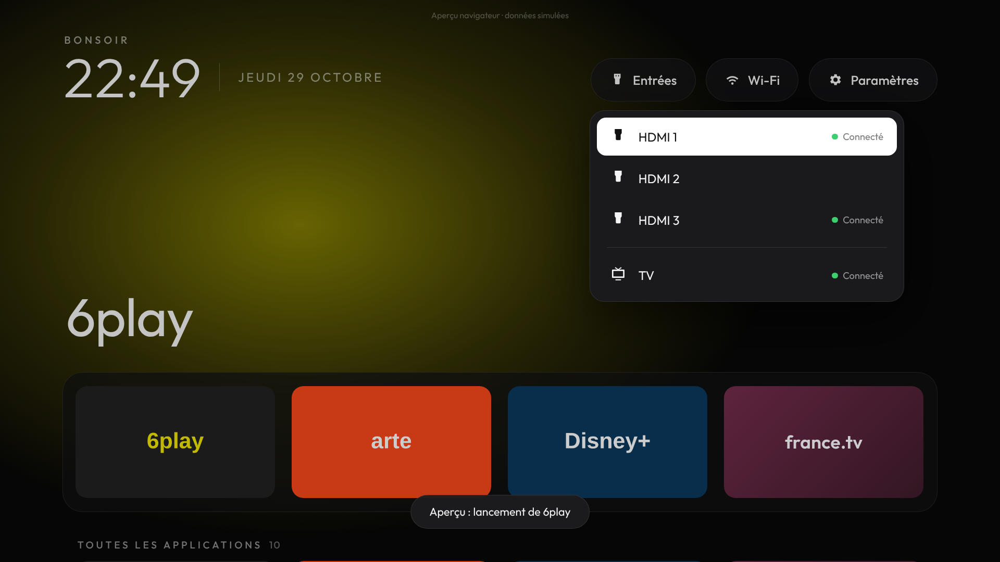

# TeleCoding

Un écran d'accueil personnel pour ma TV **Samsung UE43CU7025** : sans publicité, sans abonnement, sans serveur. On y trouve mes applications et mes entrées HDMI, et tout se pilote à la télécommande.



Le design reprend celui du launcher Android [CleanYourTV](https://github.com/Gathin23/cleanyourtv) (licence MIT), adapté à Tizen :
- un **halo** qui prend la couleur de l'appli sélectionnée ;
- le **nom de l'appli en grand** au-dessus d'une **bande de grandes cartes** (les favoris) ;
- la **grille** de toutes les applis en dessous ;
- en haut, la salutation, l'heure et la date, avec des **pastilles** Entrées / Wi-Fi / Paramètres.

Une partie de leur code est transposée en JavaScript : `app/js/artwork.js` reprend leur mode « uniform tiles » (`AppAdapter.java`), qui donne à chaque carte la couleur du support de l'icône et au halo sa couleur dominante. Les couleurs et arrondis viennent de leurs fichiers `pill_bg.xml`, `glass_panel.xml`, `tile_bg.xml` et `DockDecoration.java`, la police Outfit aussi. Licences : [THIRD_PARTY_NOTICES.md](THIRD_PARTY_NOTICES.md).

**Logos :** pour 17 marques (Netflix, YouTube, Spotify, Apple TV, Apple Music, Crunchyroll, Rakuten TV, Orange TV, Plex, Kodi, Twitch, Deezer…), TeleCoding affiche un logo net tiré de [Simple Icons](https://simpleicons.org). Les autres applis gardent leur icône Samsung. *Paramètres ▸ Logos des applis* permet de revenir aux icônes Samsung partout.

## Ce qu'il faut savoir sur cette TV

La CU7025 tourne sous **Tizen** (le système de Samsung), pas sous Android TV. Ça change la donne :

| Fonction | Possible ? | Comment |
|---|---|---|
| Appli personnelle sans pub | ✅ | Appli web Tizen (`.wgt`) installée en mode développeur |
| Détecter les applis installées | ✅ | `tizen.application.getAppsInfo()`, puis tri : la TV déclare ~450 entrées, surtout des services système. On garde les applis du store et les vraies applis intégrées (Netflix, Prime Video, Internet…). Les autres sont réglables dans *Paramètres ▸ Applis système* |
| Lancer une appli | ✅ | `tizen.application.launch()` |
| Entrées HDMI | ✅ (dans l'appli) | Pastille **Entrées** (menu déroulant) ou rangée optionnelle. `tizen.tvwindow.setSource()` : l'entrée s'affiche en plein écran *dans* TeleCoding, et Retour ramène à l'accueil |
| Remplacer le Smart Hub / la touche HOME | ❌ | Impossible sur Tizen pour une appli tierce. HOME ouvre toujours le Smart Hub |
| Ouvrir TeleCoding à l'allumage | ⚠️ | Réglage Samsung « Exécution auto. de la dernière appli », à activer soi-même |

Limites connues de l'affichage HDMI dans l'appli : tant que TeleCoding affiche l'entrée, les flèches et OK restent captées par l'appli, donc le pilotage Anynet+ (HDMI-CEC) de l'appareil branché ne passe pas. Pour piloter une console ou une box avec la télécommande de la TV, utilise la touche **SOURCE**.

## Navigation à la télécommande

| Touche | Action |
|---|---|
| ◀ ▶ ▲ ▼ | Se déplacer (le focus est toujours visible ; une rangée retient sa dernière position) |
| OK | Ouvrir l'appli / l'entrée, ou valider |
| OK maintenu | Options de l'appli : favoris, déplacer |
| Retour | Fermer une fenêtre, quitter l'entrée HDMI, revenir au début |
| Menu / Tools / Jaune | Options de l'élément sélectionné |
| Bleu | Paramètres |
| HOME | Smart Hub Samsung (imposé par le système) |

## Paramètres (enregistrés sur la TV)

- **Apparence :** thème (Ambiance, qui suit la couleur de l'appli ; Minuit, Ambre, Émeraude ; Noir profond ; Noir OLED), fond d'écran (dégradés ou image par URL), applis par rangée (4, 5 ou 6), animations.
- **En-tête :** salutation, heure 12 h / 24 h, date, météo (désactivée par défaut).
- **Accueil :** favoris, rangée Entrées, ordre des rangées, ordre des applis (A → Z ou les plus utilisées), applis système, applis masquées.





La météo est la seule fonction qui sort sur Internet. Elle interroge l'API gratuite [Open-Meteo](https://open-meteo.com), sans compte ni clé, et seulement si tu l'actives.

Les captures viennent de l'aperçu navigateur : les icônes y sont dessinées pour l'occasion. Sur la TV, ce sont les icônes officielles des applis.

## Installation (PC Windows)

Toutes les commandes se lancent dans PowerShell, depuis le dossier du dépôt. Le `.\` devant est obligatoire.

Prérequis, déjà en place : Tizen Studio dans `C:\tizen-studio`, TV en mode développeur avec l'IP du PC (`192.168.1.119`), TV en `192.168.1.129`.

1. **Trouver la TV et vérifier le mode développeur**
   ```powershell
   .\find-tv
   ```
2. **Certificat Samsung** (une seule fois) : Tizen Studio → *Tools → Certificate Manager* → **+** → *Samsung* → *TV*, puis connexion au compte Samsung. Ajoute le **DUID** de la TV, que `.\install` affiche à l'étape 2. Donne au profil un nom, par exemple `TeleCoding`.
3. **Compiler, signer, installer, lancer, vérifier**
   ```powershell
   .\install -Profile TeleCoding
   ```
4. **Démarrage automatique** (manuel, aucun script ne touche aux réglages de la TV) : *Réglages → Général et confidentialité → Options d'écran de démarrage →* « Exécution auto. de la dernière appli ». Ensuite, éteins la TV pendant que TeleCoding est ouvert.

Une autre IP ? `.\install -Ip 192.168.1.xx`, ou la variable `TELECODING_TV_IP`. Tizen Studio ailleurs ? Variable `TIZEN_HOME`.

## Revenir à l'état d'origine : `restore-original-home`

```powershell
.\restore-original-home
```
(dans l'invite `cmd`, sans le `.\` : `restore-original-home`)

- TeleCoding n'a **jamais** modifié, désactivé ni supprimé le Smart Hub ou une appli Samsung. L'accueil d'origine est intact.
- Le script désinstalle TeleCoding après confirmation. Avec `-KeepApp`, il le garde. Avec `-Yes`, il ne pose pas de questions.
- Il rappelle les réglages TV à remettre : l'exécution automatique de la dernière appli et, si tu veux, le mode développeur.
- Si la TV est injoignable, il donne la marche à suivre à la main : *Applis → roue dentée → TeleCoding → Supprimer*.

## Développement

```
app/              appli Tizen (config.xml, index.html, css/, js/, fonts/)
  js/platform.js  API Tizen, avec simulation automatique dans un navigateur
  js/store.js     préférences (localStorage)
  js/focus.js     navigation spatiale à la télécommande
  js/ui.js        cartes, logos, halo
  js/artwork.js   couleurs des icônes (portage de CleanYourTV)
  js/logos.js     pack de logos (généré par tools/build-logos.py)
  js/app.js       écran d'accueil, menus, paramètres, touches
scripts/          find-tv, deploy, restore-original-home (PowerShell)
tests/            test de l'interface au clavier (Playwright)
```

Aperçu sur PC : ouvre `app/index.html` dans Chrome. Les flèches et Entrée font la télécommande, Échap fait Retour et M fait Menu. Les données sont simulées et signalées comme telles.

```bash
npm install && npm test
```

### État des tests

- ✅ **Interface, dans Chromium avec API simulées** : 73 vérifications (navigation, logos, halo, titre, lancement, menu des entrées, HDMI, favoris, masquage, paramètres, persistance, migration, aucune erreur JS).
- ⏳ **Sur la vraie TV** : pas encore testé (icônes des applis, `tvwindow`, touches couleur, appui long, scripts PowerShell).
