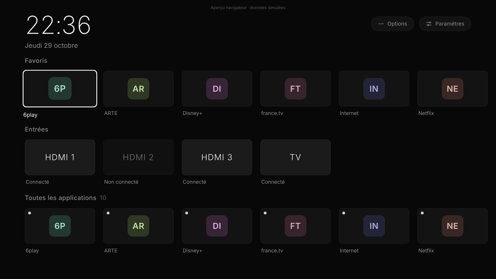
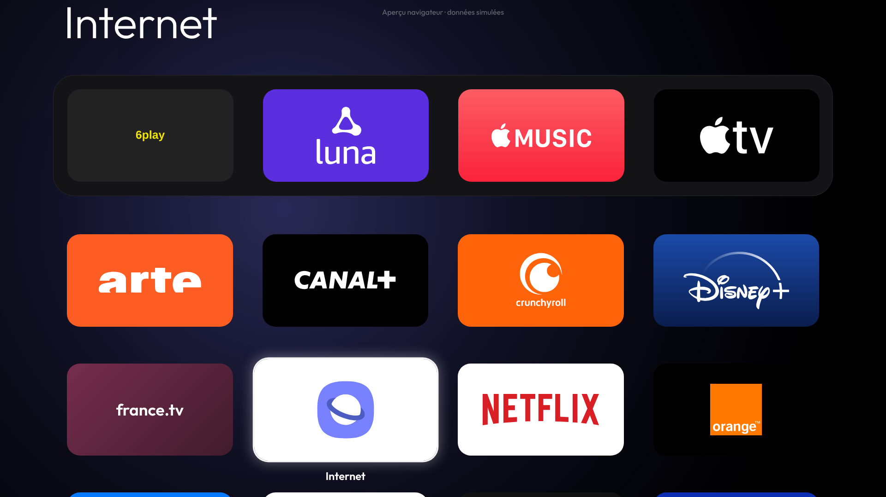
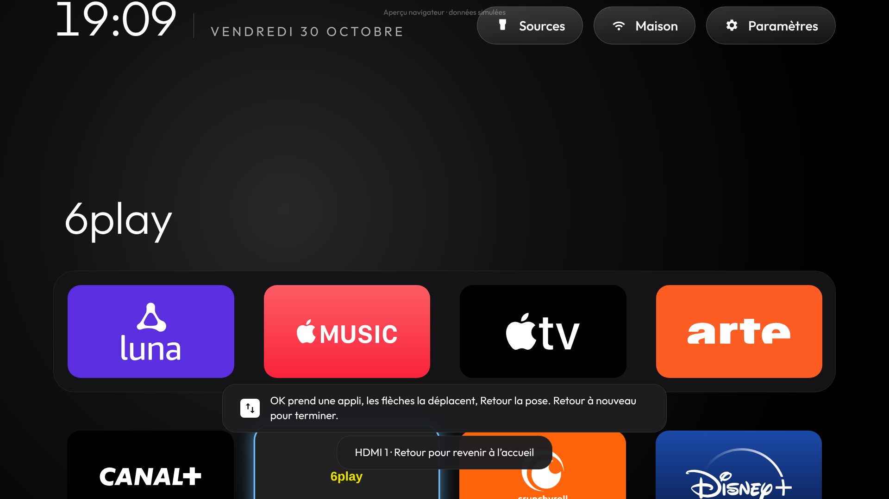
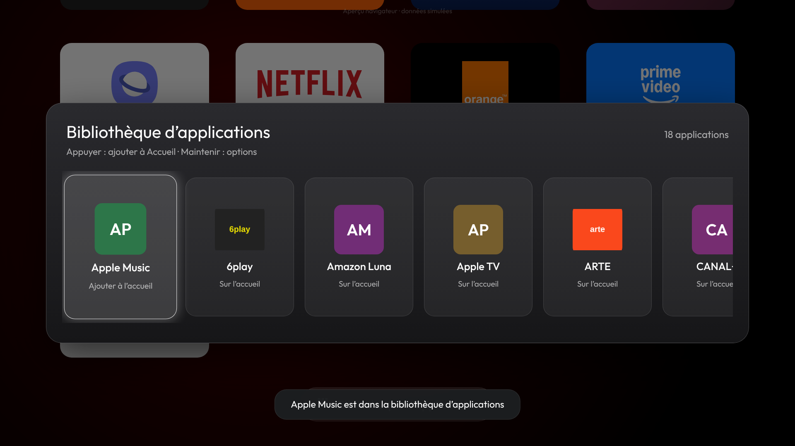
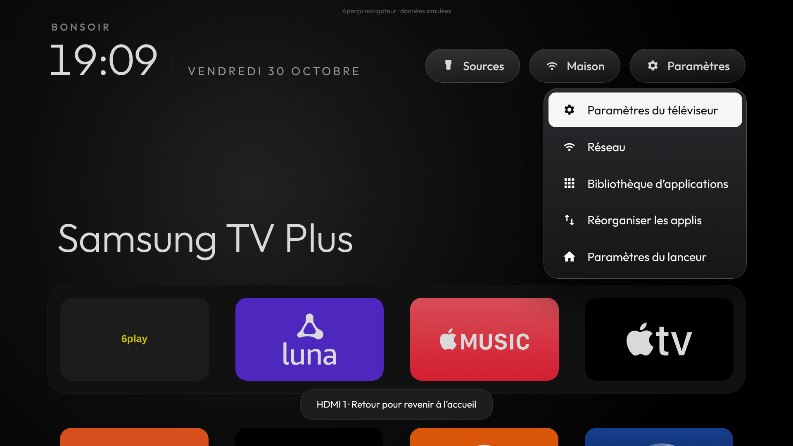

# TeleCoding

Un écran d'accueil personnel pour ma TV **Samsung UE43CU7025** : sans publicité, sans abonnement, sans serveur. On y trouve mes applications et mes sources HDMI, et tout se pilote à la télécommande.



C'est une transposition pour Samsung (Tizen) du launcher Android [CleanYourTV](https://github.com/Gathin23/cleanyourtv) (licence MIT). Leur code Java ne peut pas tourner sur une Samsung, alors tout est réécrit en HTML/JavaScript en suivant leur code et leurs captures 1920×1080 :
- **mise en page au pixel près** : salutation (« Bonjour », « Bon après-midi », « Bonsoir », « Bonne nuit », mêmes horaires), heure, date, pastilles **Sources / Wi-Fi / Paramètres** ; grand titre ; bande de 4 cartes de 360 × 201 px espacées de 64 px ; grille dessous ;
- **même modèle** : une seule liste ordonnée d'applis, les 4 premières forment la bande, les autres la grille ; une appli retirée va dans la **Bibliothèque d'applications** ; une appli installée s'ajoute à la fin ;
- **mêmes menus** : menu des sources, menu rapide du bouton Paramètres, **Réorganiser les applis** (« OK prend une appli, les flèches la déplacent, Retour la pose »), Paramètres du lanceur ;
- **mêmes textes**, repris de leur traduction française.



Une partie de leur code est transposée en JavaScript : `app/js/artwork.js` reprend leur mode « uniform tiles » (`AppAdapter.java`), qui donne à chaque carte la couleur du support de l'icône et au halo sa couleur dominante. Les couleurs et arrondis viennent de leurs fichiers `pill_bg.xml`, `glass_panel.xml`, `tile_bg.xml` et `DockDecoration.java`, la police Outfit aussi. Licences : [THIRD_PARTY_NOTICES.md](THIRD_PARTY_NOTICES.md).

**Logos :** 16 applis ont leur **vrai logo** en grande bannière, comme sur Android TV : Netflix, YouTube, Prime Video, Disney+, Spotify, ARTE, CANAL+, Crunchyroll, Apple TV, Apple Music, Xbox, Amazon Luna, Orange TV, Pluto TV, Samsung TV Plus et Internet. Les logos viennent de Wikimedia Commons, uniquement ceux sous licence libre (voir [THIRD_PARTY_NOTICES.md](THIRD_PARTY_NOTICES.md)). D'autres marques ont un logo simplifié tiré de [Simple Icons](https://simpleicons.org), et le reste garde son icône Samsung, sur une carte à sa couleur. *Paramètres du lanceur ▸ Logos des applis* permet de revenir aux icônes Samsung partout.

## Ce qu'il faut savoir sur cette TV

La CU7025 tourne sous **Tizen** (le système de Samsung), pas sous Android TV. Ça change la donne :

| Fonction | Possible ? | Comment |
|---|---|---|
| Appli personnelle sans pub | ✅ | Appli web Tizen (`.wgt`) installée en mode développeur |
| Détecter les applis installées | ✅ | `tizen.application.getAppsInfo()`, puis tri : la TV déclare ~450 entrées, surtout des services système. On garde les applis du store et les vraies applis intégrées (Netflix, Prime Video, Internet…). Les services système restent hors de l'accueil et de la bibliothèque |
| Lancer une appli | ✅ | `tizen.application.launch()` |
| Sources HDMI | ✅ (dans l'appli) | Pastille **Sources** (menu déroulant). `tizen.tvwindow.setSource()` : l'entrée s'affiche en plein écran *dans* TeleCoding, et Retour ramène à l'accueil |
| Remplacer le Smart Hub / la touche HOME | ❌ | Impossible sur Tizen pour une appli tierce. HOME ouvre toujours le Smart Hub |
| Ouvrir TeleCoding à l'allumage | ⚠️ | Réglage Samsung « Exécution auto. de la dernière appli », à activer soi-même |

Limites connues de l'affichage HDMI dans l'appli : tant que TeleCoding affiche la source, les flèches et OK restent captées par l'appli, donc le pilotage Anynet+ (HDMI-CEC) de l'appareil branché ne passe pas. Pour piloter une console ou une box avec la télécommande de la TV, utilise la touche **SOURCE**.

## Navigation à la télécommande

| Touche | Action |
|---|---|
| ◀ ▶ ▲ ▼ | Se déplacer (une ligne retient sa dernière position) |
| OK | Ouvrir l'appli ou la source, valider |
| OK maintenu | Options de l'appli : Ouvrir, Déplacer, Retirer de l'accueil |
| Retour | Fermer un menu, quitter une source HDMI, revenir à la première appli |
| Menu / Tools / Jaune | Options de l'appli sélectionnée (sinon le menu rapide) |
| Bleu | Paramètres du lanceur |
| HOME | Smart Hub Samsung (imposé par le système) |

**Réorganiser les applis** (appui long ▸ Déplacer, ou Paramètres ▸ Réorganiser les applis) : OK prend une appli, les flèches la déplacent (◀ ▶ d'une place, ▲ ▼ d'une ligne, de la bande à la grille), Retour la pose, Retour à nouveau pour terminer.



**Bibliothèque d'applications** (pastille sous la grille, ou menu Paramètres) : toutes les applis ; OK ajoute à l'accueil celle qui n'y est pas, ou ouvre celle qui y est. Les services système de Samsung n'y apparaissent que si on l'active dans les paramètres.



## Menus et paramètres

- **Sources** : HDMI, autres entrées et « TV en direct », avec « Connecté » sur les entrées branchées.
- **Paramètres** (menu rapide) : Paramètres du téléviseur, Réseau, Bibliothèque d'applications, Réorganiser les applis, Paramètres du lanceur. Les deux premiers essaient d'ouvrir les réglages Samsung ; Samsung ne documente pas cette ouverture, donc si elle est refusée, TeleCoding le dit et renvoie à la touche ⚙ de la télécommande.
- **Paramètres du lanceur** (enregistrés sur la TV) : applications par ligne (4 à 7), thème (Ambiance qui suit la couleur de l'appli, Noir, Noir OLED, Minuit, Ambre, Émeraude), fond d'écran, logos des applis, animations, salutation, format de l'heure, date, météo, sources connectées seulement, actualiser, « Suivre le thème (réinitialiser les choix) ».




La météo est la seule fonction qui sort sur Internet. Elle interroge l'API gratuite [Open-Meteo](https://open-meteo.com), sans compte ni clé, et seulement si tu l'actives.

Les captures viennent de l'aperçu navigateur : certaines icônes y sont simulées. Sur la TV, ce sont les icônes et logos réels.

## Installation (PC Windows)

Toutes les commandes se lancent dans PowerShell, depuis le dossier du dépôt. Le `.\` devant est obligatoire.

Prérequis, déjà en place : Tizen Studio dans `C:\tizen-studio`, TV en mode développeur avec l'IP du PC (`192.168.1.119`), TV en `192.168.1.129`.

1. **Trouver la TV et vérifier le mode développeur**
   ```powershell
   .\find-tv
   ```
2. **Certificat Samsung** (une seule fois) : Tizen Studio → *Tools → Certificate Manager* → **+** → *Samsung* → *TV*, puis connexion au compte Samsung. Ajoute le **DUID** de la TV, que `.\install` affiche à l'étape 2. Donne au profil un nom, par exemple `TeleCoding`.
3. **Compiler, signer, installer, lancer, vérifier**
   ```powershell
   .\install -Profile TeleCoding
   ```
4. **Démarrage automatique** (manuel, aucun script ne touche aux réglages de la TV) : *Réglages → Général et confidentialité → Options d'écran de démarrage →* « Exécution auto. de la dernière appli ». Ensuite, éteins la TV pendant que TeleCoding est ouvert.

Une autre IP ? `.\install -Ip 192.168.1.xx`, ou la variable `TELECODING_TV_IP`. Tizen Studio ailleurs ? Variable `TIZEN_HOME`.

## Revenir à l'état d'origine : `restore-original-home`

```powershell
.\restore-original-home
```
(dans l'invite `cmd`, sans le `.\` : `restore-original-home`)

- TeleCoding n'a **jamais** modifié, désactivé ni supprimé le Smart Hub ou une appli Samsung. L'accueil d'origine est intact.
- Le script désinstalle TeleCoding après confirmation. Avec `-KeepApp`, il le garde. Avec `-Yes`, il ne pose pas de questions.
- Il rappelle les réglages TV à remettre : l'exécution automatique de la dernière appli et, si tu veux, le mode développeur.
- Si la TV est injoignable, il donne la marche à suivre à la main : *Applis → roue dentée → TeleCoding → Supprimer*.

## Développement

```
app/              appli Tizen (config.xml, index.html, css/, js/, fonts/)
  js/platform.js  API Tizen, avec simulation automatique dans un navigateur
  js/store.js     préférences (localStorage)
  js/focus.js     navigation spatiale à la télécommande
  js/ui.js        cartes, logos, halo
  js/artwork.js   couleurs des icônes (portage de CleanYourTV)
  js/logos.js     logos simplifiés (généré par tools/build-logos.py)
  js/banners.js   bannières à logo officiel (fichiers dans app/logos/)
  js/app.js       écran d'accueil, menus, paramètres, touches
scripts/          find-tv, deploy, restore-original-home (PowerShell)
tests/            test de l'interface au clavier (Playwright)
```

Aperçu sur PC : ouvre `app/index.html` dans Chrome. Les flèches et Entrée font la télécommande, Échap fait Retour et M fait Menu. Les données sont simulées et signalées comme telles.

```bash
npm install && npm test
```

### Fluidité

`npm run perf` parcourt l'accueil avec un processeur ralenti 6 fois (proche d'une TV) et mesure le temps passé à dessiner. Ce qui rend TeleCoding léger :
- **le défilement passe par la carte graphique** : la page, la bande et les menus glissent avec `transform` au lieu de défiler, donc rien n'est redessiné ;
- **le halo est un petit dégradé de 192 × 108 px** agrandi par la carte graphique, avec un fondu entre deux calques (méthode de CleanYourTV, `setAmbient`), au lieu d'un dégradé plein écran redessiné à chaque appli ;
- **pas d'ombre floue ni de filtre CSS** : l'anneau de sélection est fait d'anneaux nets, et les logos à passer en blanc sont recolorés une seule fois ;
- **les couleurs des icônes sont mémorisées** d'un lancement à l'autre, et la dernière liste d'applis s'affiche tout de suite au démarrage.

- **les cartes ne découpent pas leur contenu aux coins arrondis** : sur une puce graphique de TV, chaque carte animée découpée demande un masque, très lent ;
- **un compteur d'images par seconde** s'affiche en haut à droite avec *Paramètres du lanceur ▸ Afficher les performances*, pour mesurer sur la TV elle-même.

Mesuré dans Chromium (16 appuis de télécommande) : rastérisation de 918 ms à environ 170 ms, peinture de 376 ms à environ 200 ms.

### État des tests

- ✅ **Interface, dans Chromium avec API simulées** : 74 vérifications (navigation, logos, halo, sources, menu rapide, réorganisation, bibliothèque, paramètres, persistance, migration, aucune erreur JS).
- ⏳ **Sur la vraie TV** : pas encore testé (icônes des applis, `tvwindow`, touches couleur, appui long, scripts PowerShell).
